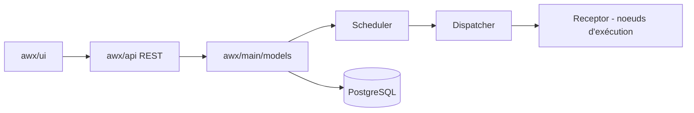

# ansible/awx

> Web interface, REST API and task engine on top of Ansible, upstream of Red Hat Ansible Automation Platform.

## The problem
Running Ansible playbooks as a team, with permissions, history and scheduling, requires a central controller.

## What it actually does
The README is short and puts forward a warning: the last release dates from July 2, 2024, and releases are paused during a major overhaul. From the code: a Django application with REST API, scheduler, dispatcher, Receptor execution mesh, WebSocket, notifications (email, Slack, PagerDuty…), PostgreSQL and Redis, plus an Ansible collection and the `awxkit` client.

## How it is wired

## Trying it
No command in the README: it points to the installation guide and the documentation.

## Cost and gotchas
Heavy stack (PostgreSQL, Redis, distributed execution). Releases paused: no recent stable version to install. 1,873 open issues. License present but not identified by GitHub.

## What it is not
It is not a supported product: it is the community upstream of a commercial product. It is not a data pipeline orchestrator.

## Alternatives
No alternative named in the README (Red Hat Ansible Automation Platform is cited there as the downstream product).

## For you
Worth watching: relevant for automating infrastructure, but releases are paused and the license needs confirming before any deployment.
