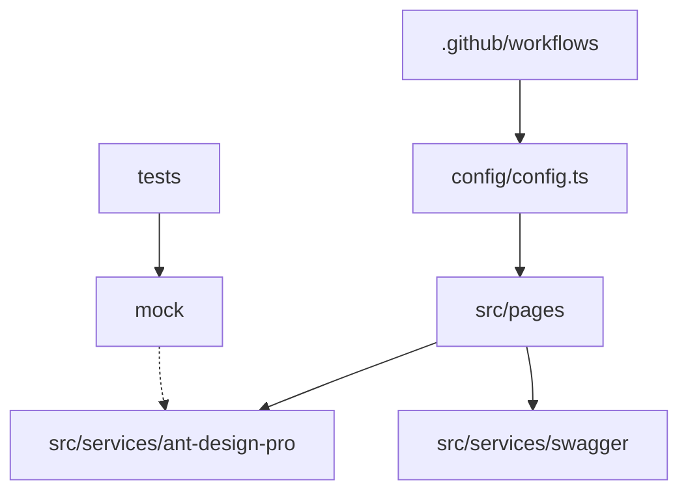

# ant-design/ant-design-pro

> React template for enterprise applications, with page models, i18n and a built-in AI assistant.

## The problem
Building a consistent back office (forms, lists, dashboards, login) starts from scratch on every project.

## What it actually does
React 19, Umi Max 4 and antd 6 skeleton: routes, typical pages, services, mocks, tests, locales, Tailwind themes. Ships two Claude Code skills (`/pro-upgrade`, `/antd`). A `npm run simple` option reduces the template.

## How it is wired


## Trying it
```bash
git clone --depth=1 https://github.com/ant-design/ant-design-pro.git myapp
cd myapp
npm install
npm start
npm run build
```

## Cost and gotchas
Free. `npm run simple` deletes files irreversibly. The Umi/antd ecosystem has to be learned.

## What it is not
Not a backend. Not an installable library: a template to copy.

## Alternatives
No alternative named in the README.

## For you
Ignore unless you need an enterprise React back office: no direct link with data, AI or MLOps work.
