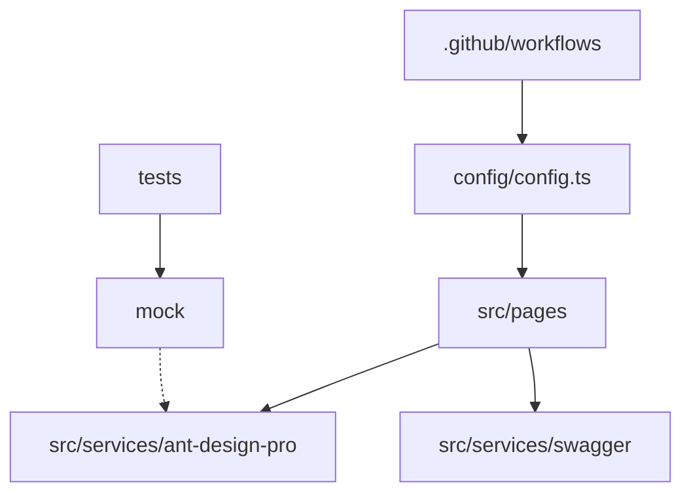

# ant-design/ant-design-pro

> Gabarit React pour applications d'entreprise, avec modèles de pages, i18n et assistant IA intégré.

## Le problème
Monter un back-office cohérent (formulaires, listes, tableaux de bord, connexion) repart de zéro à chaque projet.

## Ce que ça fait vraiment
Squelette React 19, Umi Max 4 et antd 6 : routes, pages types, services, mocks, tests, locales, thèmes Tailwind. Livre deux compétences Claude Code (`/pro-upgrade`, `/antd`). Option `npm run simple` pour réduire le gabarit.

## Comment c'est branché


## Essayer
```bash
git clone --depth=1 https://github.com/ant-design/ant-design-pro.git myapp
cd myapp
npm install
npm start
npm run build
```

## Coût et pièges
Gratuit. `npm run simple` supprime des fichiers de façon irréversible. Écosystème Umi/antd à apprendre.

## Ce que ce n'est pas
Pas un backend. Pas une bibliothèque installable : un gabarit à copier.

## Alternatives
Aucune alternative nommée dans le README.

## Pour toi
À ignorer sauf besoin d'un back-office React d'entreprise : sans lien direct avec les travaux data, IA ou MLOps.

