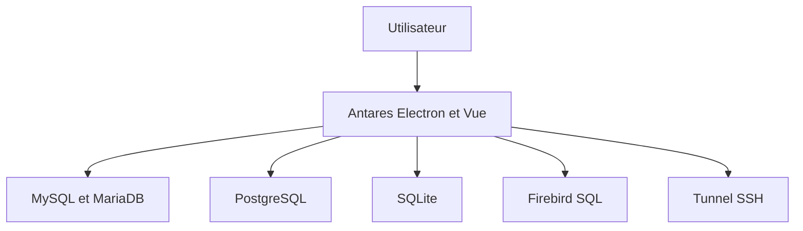

# antares-sql/antares

> Free desktop SQL client built with Electron and Vue for MySQL, PostgreSQL, SQLite and Firebird.

## The problem
Full-featured SQL clients are often paid or heavy; you want a free, simple, cross-platform tool.

## What it actually does
Multiple connections, management of databases, tables, indexes, foreign keys, views, triggers and routines. Editor with autocompletion, history of the last 1000 queries, SSH tunnel, dump import and export, fake data generation. Light and dark themes, customizable shortcuts.

## How it is wired
Simplified diagram based on the fiche, no diagram provided.

## Trying it
No command in the README: download the `.AppImage`, install from FlatHub, Snap Store, AUR, PPA or Microsoft Store, or the `.dmg` on macOS.

## Cost and gotchas
Free, with no premium feature announced. Windows and macOS binaries are unsigned: warnings to work around. The last push dates from October 2025.

## What it is not
Under development according to the author: DuckDB and SQL Server are not supported. No ARM version for Windows or macOS.

## Alternatives
No alternative named in the README.

## For you
Worth watching: handy for exploring databases, but without DuckDB or data warehouses it covers data use poorly, and recent activity has slowed.
