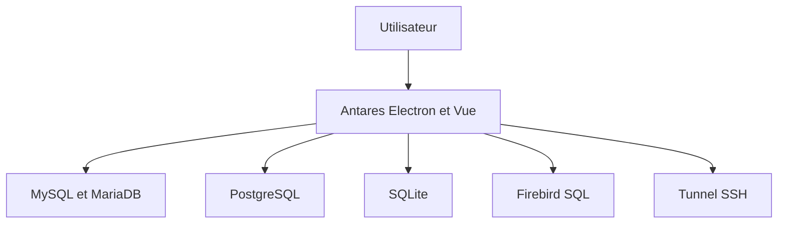

# antares-sql/antares

> Client SQL de bureau Electron et Vue pour MySQL, PostgreSQL, SQLite et Firebird, gratuit.

## Le problème
Les clients SQL complets sont souvent payants ou lourds ; on veut un outil libre, simple et multiplateforme.

## Ce que ça fait vraiment
Connexions multiples, gestion des bases, tables, index, clés étrangères, vues, triggers et routines. Éditeur avec autocomplétion, historique des 1000 dernières requêtes, tunnel SSH, import et export de dumps, génération de fausses données. Thèmes clair et sombre, raccourcis personnalisables.

## Comment c'est branché
Schéma simplifié d'après la fiche, sans diagramme fourni.

## Essayer
Aucune commande dans le README : télécharger le `.AppImage`, installer depuis FlatHub, Snap Store, AUR, PPA ou Microsoft Store, ou le `.dmg` sur macOS.

## Coût et pièges
Gratuit, sans fonction premium annoncée. Binaires Windows et macOS non signés : avertissements à contourner. Le dernier push date d'octobre 2025.

## Ce que ce n'est pas
En développement d'après l'auteur : DuckDB et SQL Server ne sont pas pris en charge. Pas de version ARM pour Windows ni macOS.

## Alternatives
Aucune alternative nommée dans le README.

## Pour toi
À surveiller : pratique pour explorer des bases, mais sans DuckDB ni entrepôts de données, il couvre mal un usage data, et l'activité récente a ralenti.

