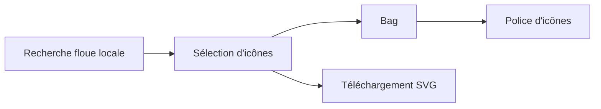

# antfu-collective/icones

> Icon search site with selection and export to an icon font, for web developers.

## The problem
Finding and retrieving SVG icons from many sets, without going through web requests.

## What it actually does
Local fuzzy search, a "Bag" to group icons into a ready-to-use font, copy of usage scripts and SVG download. Dark mode, favorite collections, category filters. Built with Vite and Vue 3.

## How it is wired
Simplified diagram based on the sheet, no diagram provided.

## Trying it
No command documented in the README.

## Cost and gotchas
Free. Very short README: little information about hosting or local installation.

## What it is not
Not an icon library: it is an interface to browse and export them.

## Alternatives
No alternative named in the README.

## For you
Ignore: web design tool unrelated to data / AI / MLOps work.
