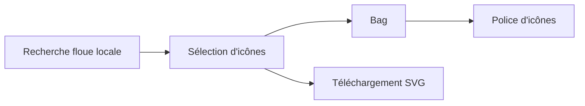

# antfu-collective/icones

> Site de recherche d'icônes avec sélection et export en police d'icônes, pour développeurs web.

## Le problème
Trouver et récupérer des icônes SVG issues de nombreux jeux, sans passer par des requêtes web.

## Ce que ça fait vraiment
Recherche floue locale, « Bag » pour regrouper des icônes en police prête à l'emploi, copie de scripts d'usage et téléchargement SVG. Mode sombre, favoris de collections, filtres par catégorie. Construit avec Vite et Vue 3.

## Comment c'est branché
Schéma simplifié d'après la fiche, sans diagramme fourni.

## Essayer
Aucune commande documentée dans le README.

## Coût et pièges
Gratuit. README très court : peu d'informations sur l'hébergement ou l'installation locale.

## Ce que ce n'est pas
Ce n'est pas une bibliothèque d'icônes : c'est une interface pour les parcourir et les exporter.

## Alternatives
Aucune alternative nommée dans le README.

## Pour toi
À ignorer : outil de design web sans rapport avec un travail data / IA / MLOps.

