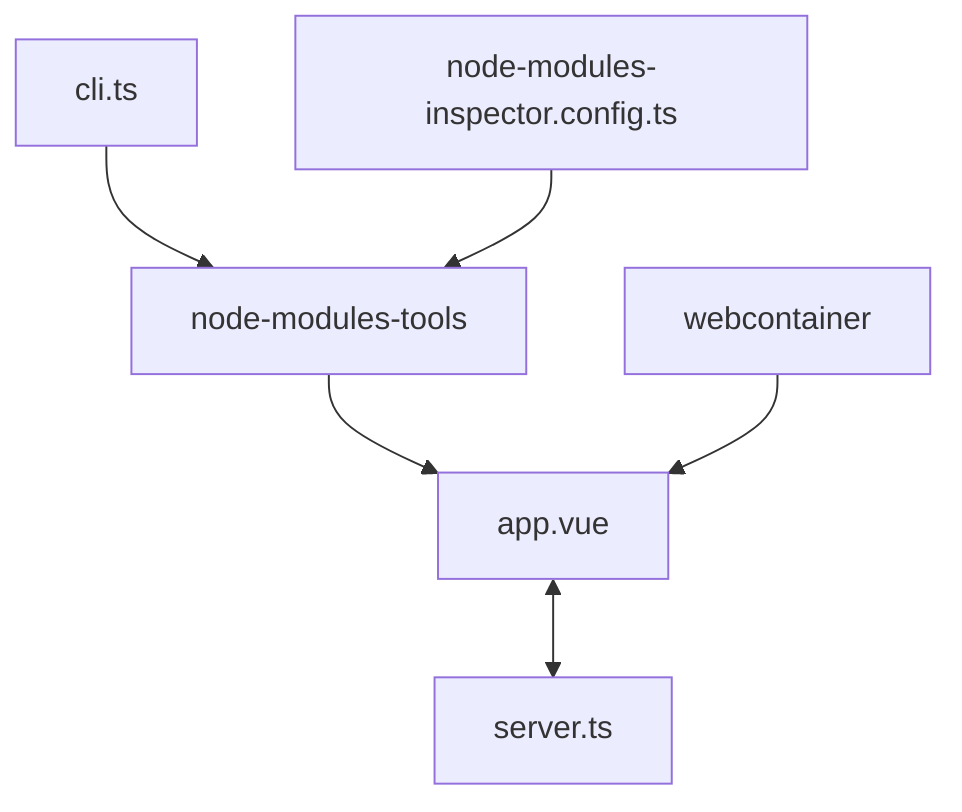

# antfu/node-modules-inspector

> Visualises the node_modules folder of a pnpm, npm or bun project: dependencies, duplicates, sizes.

## The problem
A node_modules folder bloats without anyone knowing which packages are duplicated, heavy or badly published.

## What it actually does
Launches a local web interface that draws the dependency graph (tree, treemap, sunburst). Three command-line reports: duplicates, sizes, upgrade suggestions with publint. The same reports are served as MCP tools for agents. A static build is possible, as well as an online version via WebContainer.

## How it is wired
Diagram based on the code diagram.



## Trying it
```bash
npx node-modules-inspector
npx node-modules-inspector build
npx node-modules-inspector report duplicates --json | jq '.[].name'
npx node-modules-inspector mcp
```

## Cost and gotchas
Free, Node required. Only pnpm, npm and bun are supported; the publint integration is marked experimental.

## What it is not
Not a vulnerability scanner. It describes the structure and weight of dependencies, not their security.

## Alternatives
npmgraph, which the project draws inspiration from (cited in the credits), for an online view without installation.

## For you
Worth watching: useful if you manage Node projects or MCP tools, with no direct link to data/AI work.
