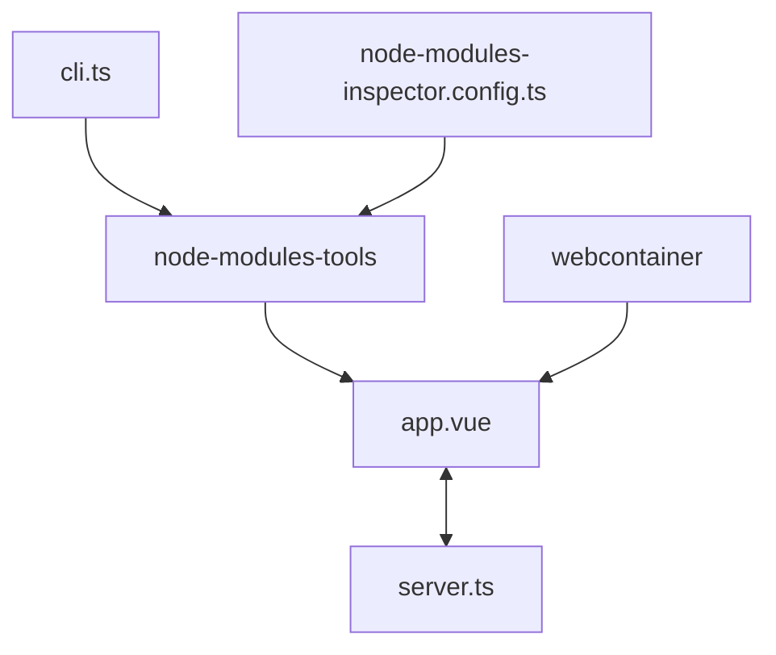

# antfu/node-modules-inspector

> Visualise le dossier node_modules d'un projet pnpm, npm ou bun : dépendances, doublons, tailles.

## Le problème
Un node_modules gonfle sans qu'on sache quels paquets sont dupliqués, lourds ou mal publiés.

## Ce que ça fait vraiment
Lance une interface web locale qui trace le graphe des dépendances (arbre, treemap, sunburst). Trois rapports en ligne de commande : doublons, tailles, pistes de mise à jour avec publint. Les mêmes rapports sont servis comme outils MCP pour des agents. Un build statique est possible, ainsi qu'une version en ligne via WebContainer.

## Comment c'est branché
Schéma d'après le diagramme du code.



## Essayer
```bash
npx node-modules-inspector
npx node-modules-inspector build
npx node-modules-inspector report duplicates --json | jq '.[].name'
npx node-modules-inspector mcp
```

## Coût et pièges
Gratuit, Node requis. Seuls pnpm, npm et bun sont gérés ; l'intégration publint est marquée expérimentale.

## Ce que ce n'est pas
Pas un scanner de vulnérabilités. Il décrit la structure et le poids des dépendances, pas leur sécurité.

## Alternatives
npmgraph, dont le projet s'inspire (cité dans les crédits), pour une vue en ligne sans installation.

## Pour toi
À surveiller : utile si tu gères des projets Node ou des outils MCP, sans lien direct avec le travail data/IA.

