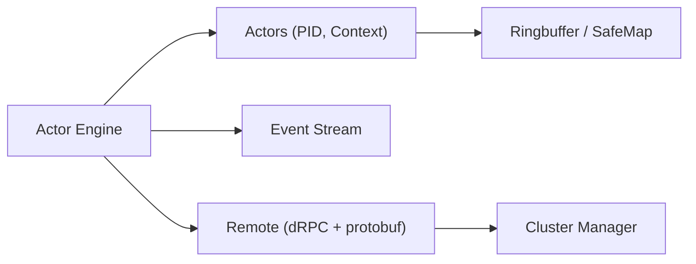

# anthdm/hollywood

> Actor engine for Go, designed for low latency: game servers, ad brokers, trading engines.

## The problem
Building concurrent and distributed systems in Go without manually handling locks, channels and failure supervision.

## What it actually does
An `Engine` creates actors (`Spawn`), each identified by a PID, with an inbox and a lifecycle (Initialized, Started, Stopped). Restart after panic, fire-and-forget or request-response messaging, event streams (dead letters), middleware, `slog` logs. Remote actors go through dRPC and protobuf, with TLS; a cluster mode handles discovery. Also compiles to WASM.

## How it is wired


## Trying it
```bash
go get github.com/anthdm/hollywood/...
make bench
make test
```

## Cost and gotchas
Free. Go 1.21 minimum. Messages crossing the network must be serializable with protobuf, so passed by pointer. Unlistened events are lost: at least one actor must subscribe to `DeadLetterEvent`.

## What it is not
Not a data processing framework. The throughput figures (about 3.5 million messages per second in their benchmark, "10 million in under a second" at the top of the README) come from the authors. The README cites only one production use: Sensora IoT and Market Monkey Terminal.

## Alternatives
No alternative named in the README.

## For you
Ignore: a Go concurrency library, outside your data, AI or MLOps scope, unless you build low-latency Go services.
