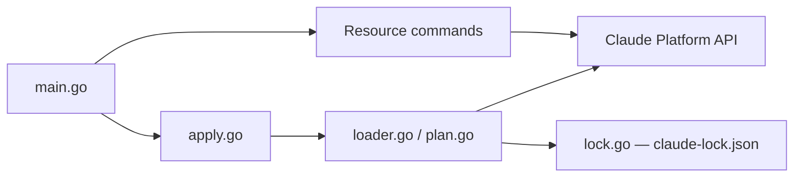

# anthropics/anthropic-cli

> Official `ant` CLI for the Claude Platform: call the API and manage agents and resources from the terminal.

## The problem
Calling the Claude API and managing agents, sessions and files requires code or curl, and agents configured in the Console are not versioned.

## What it actually does
`ant <resource> <command>` covers the API endpoints (messages, models, beta agents, sessions, files). Outputs can be filtered jq-style (`--transform`). `ant apply` syncs agents, skills, environments, vaults and deployments from files in the repository, with a `claude-lock.json` file, a plan before applying and detection of changes made in the Console.

## How it is wired


## Trying it
```bash
brew install anthropics/tap/ant
ant auth login
ant models list
ant messages create \
  --model claude-opus-4-8 \
  --max-tokens 1024 \
  --message '{role: user, content: "Hello, Claude"}'
ant apply ./agents ./deployments ./environments ./skills
```

## Cost and gotchas
Claude Console account or `ANTHROPIC_API_KEY` key: calls are billed. Passing the key via `--api-key` is deprecated; prefer `--api-key-stdin`. `--prune` can archive a vault and destroy its secrets.

## What it is not
Not a chat client nor Claude Code. `ant apply` does not protect against two concurrent runs (the README advises serializing in CI).

## Alternatives
No alternative named in the README.

## For you
Adopt if you use the Claude API or its agents: it is the official tool and it makes agent configuration reviewable like code.
