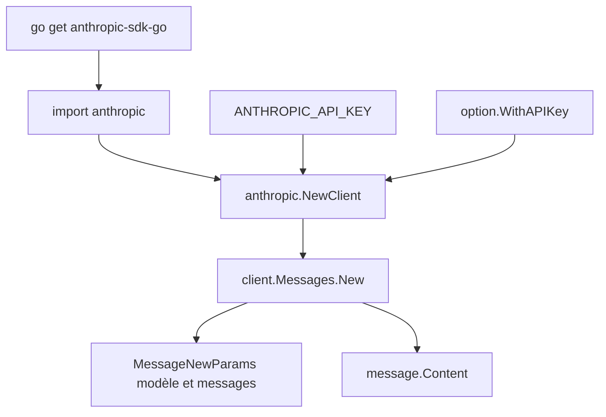

# anthropics/anthropic-sdk-go

> Official Go SDK giving access to the Claude API from a Go application.

## The problem
Calling the Claude API in Go without an SDK means writing serialization, error handling and schema-change tracking by hand.
Every Go service then reimplements the same layer.

## What it actually does
Provides a client built by `anthropic.NewClient`, the key being read by default from `ANTHROPIC_API_KEY` or passed via `option.WithAPIKey`.
`client.Messages.New` takes a `MessageNewParams` with `MaxTokens`, the list of messages and the model, and returns the message and its content.
Typed constructors (`NewUserMessage`, `NewTextBlock`) avoid composing the structures by hand.
Models are exposed as constants, for example `anthropic.ModelClaudeOpus4_6`.

## How it is wired


## Trying it
```sh
go get -u 'github.com/anthropics/anthropic-sdk-go@v1.74.0'
```

## Cost and gotchas
API usage is billed: the key and the consumption remain at your expense.
Go 1.24 minimum. A key passed in plain text in the code, as in the README example, should be replaced by the environment variable.

## What it is not
Not an agent nor a framework: it is an API client, the tool loop and application logic remain to be written.
Not complete documentation: the README explicitly refers to the official site for all the detail.
Not a way to run a model locally.

## Alternatives
No alternative named in the README.

## For you
Irrelevant as long as your stack is in Python; the useful landmark is the up-to-date model constant to check a version.
