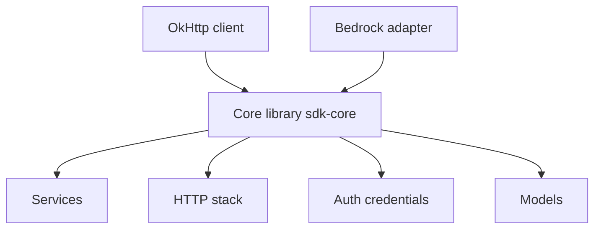

# anthropics/anthropic-sdk-java

> Official Java SDK for calling the Claude API, for JVM developers.

## The problem
Calling the Claude API from Java without a typed client means handling HTTP, authentication, retries and streams by hand.

## What it actually does
A multi-module library: a typed core (clients, services, models, HTTP stack with retries, SSE streams, pagination) and adapters for OkHttp, Bedrock, Vertex, Foundry, AWS and MCP. The key is read from `ANTHROPIC_API_KEY`. An examples module covers messages, streaming, tools and token counting.

## How it is wired


## Trying it
```bash
# Gradle
# implementation("com.anthropic:anthropic-java:3.6.0")
# Variable d'environnement attendue : ANTHROPIC_API_KEY
```

## Cost and gotchas
API key and calls billed to you. Java 8 or later required, not covered by the prerequisites list. The code is apparently generated from an API schema: beta versions evolve quickly.

## What it is not
Not an agent framework or an application. Not a Python SDK.

## Alternatives
No alternative named in the README.

## For you
Ignore unless your stack is JVM: a Python data profile will use the Python SDK.
