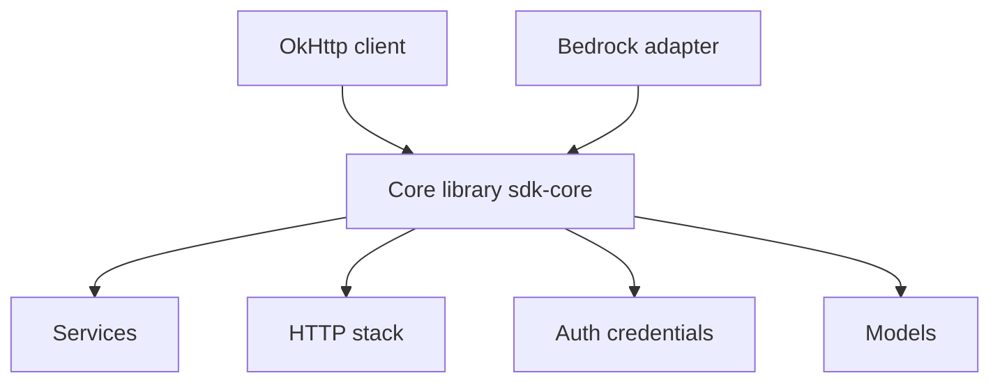

# anthropics/anthropic-sdk-java

> SDK Java officiel pour appeler l'API Claude, pour les développeurs JVM.

## Le problème
Appeler l'API Claude depuis Java sans client typé oblige à gérer HTTP, authentification, reprises et flux à la main.

## Ce que ça fait vraiment
Une bibliothèque multi-module : un cœur typé (clients, services, modèles, pile HTTP avec reprises, flux SSE, pagination) et des adaptateurs OkHttp, Bedrock, Vertex, Foundry, AWS et MCP. La clé se lit dans `ANTHROPIC_API_KEY`. Un module d'exemples couvre messages, streaming, outils et comptage de jetons.

## Comment c'est branché


## Essayer
```bash
# Gradle
# implementation("com.anthropic:anthropic-java:3.6.0")
# Variable d'environnement attendue : ANTHROPIC_API_KEY
```

## Coût et pièges
Clé d'API et appels facturés à ta charge. Java 8 ou plus requis, non couvert par la liste de prérequis. Le code est apparemment généré à partir d'un schéma d'API : des versions bêta évoluent vite.

## Ce que ce n'est pas
Pas un framework d'agents ni une application. Pas un SDK Python.

## Alternatives
Aucune alternative nommée dans le README.

## Pour toi
À ignorer sauf si ta pile est JVM : un profil data en Python utilisera le SDK Python.

