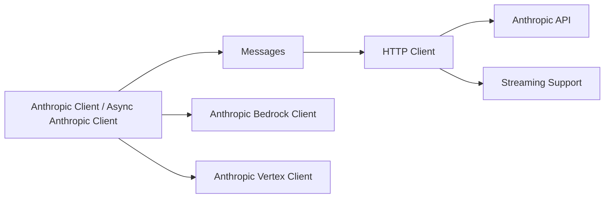

# anthropics/anthropic-sdk-python

> Official Python library for calling the Claude API from an application.

## The problem
Calling the Claude API by hand (HTTP, authentication, streaming, errors) is repetitive; the SDK wraps it.

## What it actually does
The README is very short, right at the 800-character threshold (minimal sheet). It shows installation, a `client.messages.create(...)` example with the key read from `ANTHROPIC_API_KEY`, and the Python 3.10+ requirement. It points to the online documentation and to a migration guide from the 0.x series. According to the code: `Anthropic` and `AsyncAnthropic` clients, Bedrock and Vertex variants, messages, models and beta batches resources, on httpx.

## How it is wired


## Trying it
```bash
pip install anthropic
```
Then create an `Anthropic(...)` and call `client.messages.create(...)`, as in the README.

## Cost and gotchas
The SDK is free, calls are billed by Anthropic (API key). The architecture description mentions Python 3.8+, the README requires 3.10+: follow the README. Migrating from 0.x requires reading the guide.

## What it is not
It is not an agent framework or an orchestrator: it gives direct access to the API. The list of features, error handling and news are in the documentation, not in the README.

## Alternatives
No alternative named in the README.

## For you
Adopt it: it is the official client for the Claude API, under the MIT license, maintained (activity in September 2026); the README is thin, the online documentation is authoritative.
