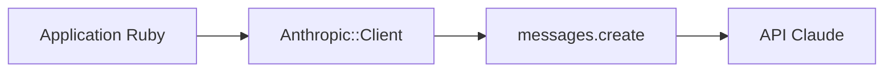

# anthropics/anthropic-sdk-ruby

> Official Ruby SDK for calling the Claude API, for Ruby developers.

## The problem
Calling the Claude API from Ruby without writing the HTTP requests and response decoding yourself.

## What it actually does
An "anthropic" gem provides a client configured by API key (ANTHROPIC_API_KEY variable by default) and a messages.create method to send messages to a model. The README is short and points to the online documentation.

## How it is wired
Simplified diagram based on the sheet, no diagram provided.


## Trying it
```bash
# Gemfile
gem "anthropic", "~> 2.6.0"
```
```ruby
require "bundler/setup"
require "anthropic"

anthropic = Anthropic::Client.new(
  api_key: ENV["ANTHROPIC_API_KEY"]
)

message = anthropic.messages.create(
  max_tokens: 1024,
  messages: [{role: "user", content: "Hello, Claude"}],
  model: Anthropic::Model::CLAUDE_OPUS_5_5
)

puts(message.content)
```

## Cost and gotchas
An Anthropic API key is required, pay-as-you-go billing at your expense. Ruby 3.2.0 or later is needed: this Ruby version is not in the list of prerequisites.

## What it is not
Not an agent framework nor an autonomous tool: only an API client. Useless outside Ruby.

## Alternatives
No alternative named in the README.

## For you
Ignore if you work in Python: this SDK only serves a Ruby stack, and nothing in the README adapts it to data or MLOps work.
