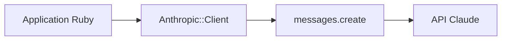

# anthropics/anthropic-sdk-ruby

> SDK Ruby officiel pour appeler l'API Claude, pour les développeurs Ruby.

## Le problème
Appeler l'API Claude depuis Ruby sans écrire soi-même les requêtes HTTP et le décodage des réponses.

## Ce que ça fait vraiment
Une gem « anthropic » fournit un client configuré par clé d'API (variable ANTHROPIC_API_KEY par défaut) et une méthode messages.create pour envoyer des messages à un modèle. Le README est court et renvoie vers la documentation en ligne.

## Comment c'est branché
Schéma simplifié d'après la fiche, sans diagramme fourni.


## Essayer
```bash
# Gemfile
gem "anthropic", "~> 2.6.0"
```
```ruby
require "bundler/setup"
require "anthropic"

anthropic = Anthropic::Client.new(
  api_key: ENV["ANTHROPIC_API_KEY"]
)

message = anthropic.messages.create(
  max_tokens: 1024,
  messages: [{role: "user", content: "Hello, Claude"}],
  model: Anthropic::Model::CLAUDE_OPUS_5_5
)

puts(message.content)
```

## Coût et pièges
Clé d'API Anthropic obligatoire, facturation à l'usage à ta charge. Il faut Ruby 3.2.0 ou plus : cette version de Ruby n'existe pas dans la liste des prérequis.

## Ce que ce n'est pas
Pas un framework d'agents ni un outil autonome : seulement un client d'API. Inutile hors de Ruby.

## Alternatives
Aucune alternative nommée dans le README.

## Pour toi
À ignorer si tu travailles en Python : ce SDK ne sert que pour une pile Ruby, et rien dans le README ne l'adapte au travail data ou MLOps.

