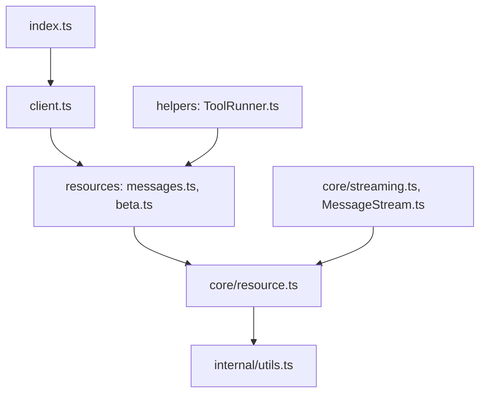

# anthropics/anthropic-sdk-typescript

> Official SDK for calling the Claude API from server-side TypeScript or JavaScript.

## The problem
Calling the Claude API by hand means handling HTTP requests, streaming, errors, pagination and response typing.

## What it actually does
A typed client exposes the API resources (messages, models, beta). Response streaming is handled natively. Helpers cover tools (tool runner), JSON/Zod schemas, MCP and memory. Sibling packages target AWS, Bedrock, Foundry and Vertex.

## How it is wired


## Trying it
```bash
npm install @anthropic-ai/sdk
```

```js
import Anthropic from '@anthropic-ai/sdk';
const client = new Anthropic({ apiKey: process.env['ANTHROPIC_API_KEY'] });
const message = await client.messages.create({
  max_tokens: 1024,
  messages: [{ role: 'user', content: 'Hello, Claude' }],
  model: 'claude-opus-5-5',
});
```

## Cost and gotchas
An Anthropic API key is required; calls are billed by usage. In a browser, the client is blocked by default unless `dangerouslyAllowBrowser` is set, so as not to expose the key. React Native is not supported.

## What it is not
Not an agent framework: it provides the client and tool helpers. It does not handle the browser front end safely: the key stays server-side.

## Alternatives
No alternative named in the README.

## For you
Adopt if you integrate Claude into a Node, Deno or Bun service: it is the official SDK, with built-in streaming and tools.
