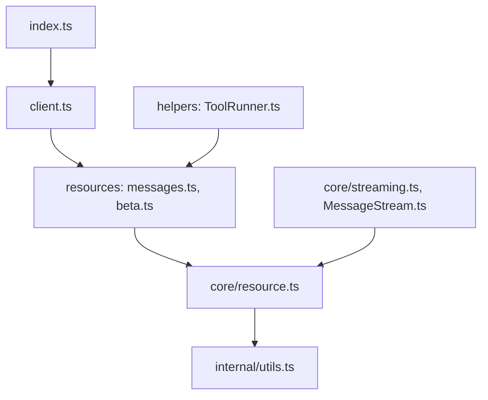

# anthropics/anthropic-sdk-typescript

> SDK officiel pour appeler l'API Claude depuis TypeScript ou JavaScript côté serveur.

## Le problème
Appeler l'API Claude à la main demande de gérer les requêtes HTTP, le streaming, les erreurs, la pagination et le typage des réponses.

## Ce que ça fait vraiment
Un client typé expose les ressources de l'API (messages, modèles, beta). Le streaming de réponses est géré nativement. Des helpers couvrent les outils (tool runner), les schémas JSON/Zod, MCP et la mémoire. Des paquets frères visent AWS, Bedrock, Foundry et Vertex.

## Comment c'est branché


## Essayer
```bash
npm install @anthropic-ai/sdk
```

```js
import Anthropic from '@anthropic-ai/sdk';
const client = new Anthropic({ apiKey: process.env['ANTHROPIC_API_KEY'] });
const message = await client.messages.create({
  max_tokens: 1024,
  messages: [{ role: 'user', content: 'Hello, Claude' }],
  model: 'claude-opus-5-5',
});
```

## Coût et pièges
Une clé d'API Anthropic est requise ; les appels sont facturés à l'usage. Dans un navigateur, le client est bloqué par défaut sauf `dangerouslyAllowBrowser`, pour ne pas exposer la clé. React Native n'est pas supporté.

## Ce que ce n'est pas
Ce n'est pas un framework d'agents : il fournit le client et des helpers d'outils. Il ne gère pas le front navigateur de façon sûre : la clé reste côté serveur.

## Alternatives
Aucune alternative nommée dans le README.

## Pour toi
À adopter si tu intègres Claude dans un service Node, Deno ou Bun : c'est le SDK officiel, avec streaming et outils intégrés.

