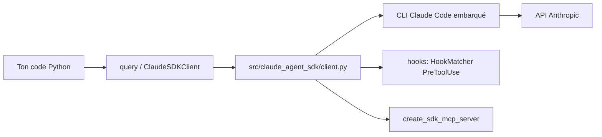

# anthropics/claude-agent-sdk-python

> Official Python SDK to drive the Claude Code agent from your own program.

## The problem
Calling the messages API by hand means rewriting the agent loop: tools, permissions,
session resumption, error handling. The Claude Code CLI already does all of that, but in a terminal.

## What it actually does
`query()` returns an async iterator of messages for a simple exchange. `ClaudeSDKClient`
opens a bidirectional conversation and unlocks two things: **custom tools**,
declared with the `@tool` decorator and served by an in-process MCP server (no subprocess),
and **hooks**, Python functions called by the application at specific points of the loop,
able to deny a tool call. The CLI is bundled in the package.

## How it is wired


## Trying it
```bash
pip install claude-agent-sdk
curl -fsSL https://claude.ai/install.sh | bash
./scripts/initial-setup.sh
python scripts/build_wheel.py --version 0.1.4
```

## Cost and gotchas
Python 3.10+. The SDK charges nothing but every turn consumes your Anthropic credit. Documented
pitfall: `allowed_tools` is a pre-approval list, not a filter — to remove a
tool you need `disallowed_tools`. The system prompt is frozen at the session's first call unless
`snapshot: False` (CLI >= 2.1.257).

## What it is not
Not a low-level API: it goes through the CLI, not directly through Messages. Not
compatible with the old Claude Code SDK — `ClaudeCodeOptions` becomes `ClaudeAgentOptions`.

## Alternatives
No alternative named in the README.

## For you
The short path to industrializing a Claude agent in Python: adopt it if you automate tool-equipped tasks.
