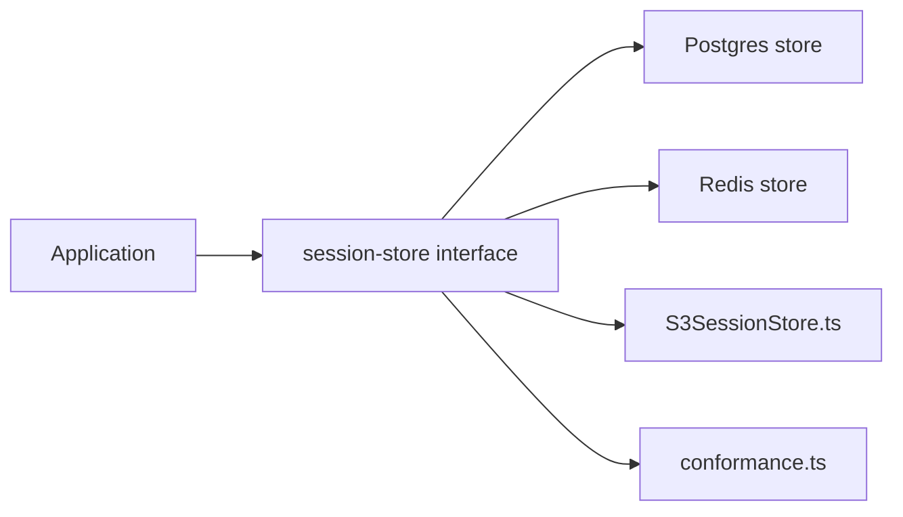

# anthropics/claude-agent-sdk-typescript

> A TypeScript SDK for building autonomous agents with Claude Code's capabilities.

## The problem
Reproducing Claude Code's agent loop (reading code, editing, running commands) in your own applications takes a lot of plumbing.

## What it actually does
The README only describes the npm installation and points to the documentation. The analyzed file tree mostly shows examples of session persistence adapters (PostgreSQL, Redis, S3), with a shared conformance suite and live tests. The core of the SDK does not appear in the excerpt.

## How it is wired


## Trying it
```sh
npm install @anthropic-ai/claude-agent-sdk
```

## Cost and gotchas
Usage is billed through your Anthropic account. The README reports the collection of usage data and feedback (including the /bug command), with limited-retention guarantees.

## What it is not
Repository with no license declared in the catalog: terms are governed by the Commercial Terms. 237 open issues. Formerly "Claude Code SDK": a migration is to be expected.

## Alternatives
No alternative named in the README.

## For you
Adopt if you build agents on Claude: official SDK, activity on 2026-10-22, but check the terms since there is no license.
