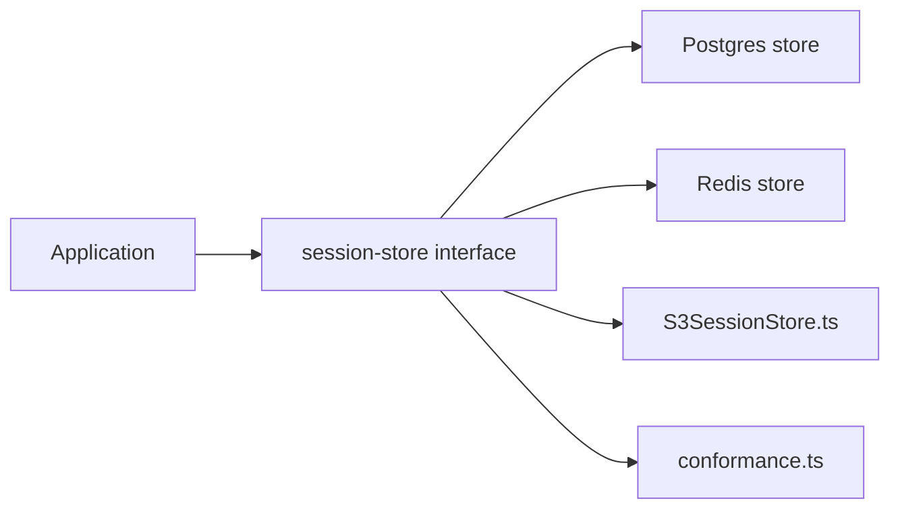

# anthropics/claude-agent-sdk-typescript

> SDK TypeScript pour construire des agents autonomes avec les capacités de Claude Code.

## Le problème
Reproduire la boucle d'agent de Claude Code (lecture de code, édition, commandes) dans ses propres applications demande beaucoup de plomberie.

## Ce que ça fait vraiment
Le README ne décrit que l'installation npm et renvoie à la documentation. L'arborescence analysée montre surtout des exemples d'adaptateurs de persistance de session (PostgreSQL, Redis, S3), avec une suite de conformité partagée et des tests live. Le cœur du SDK n'apparaît pas dans l'extrait.

## Comment c'est branché


## Essayer
```sh
npm install @anthropic-ai/claude-agent-sdk
```

## Coût et pièges
Usage facturé via ton compte Anthropic. Le README signale la collecte de données d'usage et de retours (dont la commande /bug), avec des garanties de rétention limitée.

## Ce que ce n'est pas
Dépôt sans licence déclarée dans le catalogue : conditions régies par les Commercial Terms. 237 issues ouvertes. Anciennement « Claude Code SDK » : migration à prévoir.

## Alternatives
Aucune alternative nommée dans le README.

## Pour toi
Adopter si tu construis des agents sur Claude : SDK officiel, activité du 2026-10-22, mais vérifier les conditions faute de licence.

