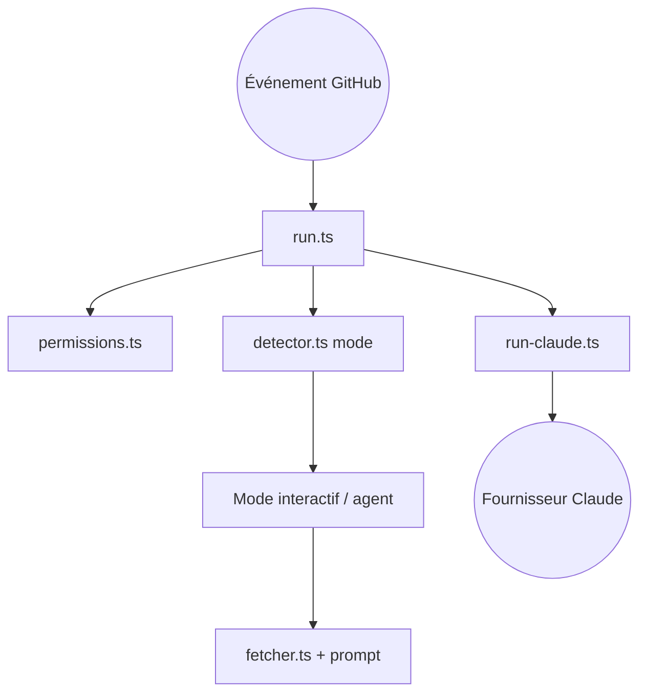

# anthropics/claude-code-action

> GitHub Action that runs Claude Code on issues and PRs, to automate review and fixes.

## The problem
Reviewing PRs, triaging issues or making small fixes takes repetitive human time.

## What it actually does
The action detects the event (@claude mention, assignment, explicit prompt), checks permissions, chooses an interactive or automation mode, fetches the GitHub context, creates a tracking comment, then runs Claude with MCP tools (GitHub, comments, files). It supports the Anthropic API, Bedrock, Vertex and Foundry, and structured JSON outputs.

## How it is wired


## Trying it
```bash
claude
/install-github-app
```

## Cost and gotchas
API calls are billed by your provider; the action runs on your runner. You must be a repository admin to install the app and secrets. The quick start only covers the direct Anthropic API.

## What it is not
Not an autonomous tool without safeguards: it acts with the permissions granted. Migration required from v0.x.

## Alternatives
No alternative named in the README.

## For you
Adopt if you already use Claude and GitHub: PR review and triage install in a few minutes, with an official publisher.
