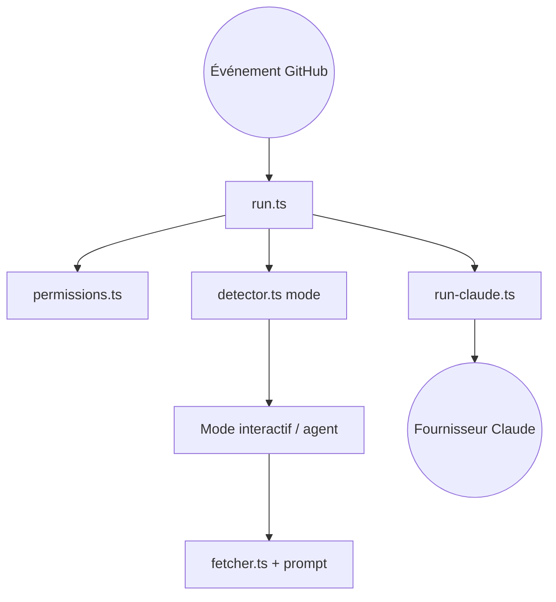

# anthropics/claude-code-action

> GitHub Action qui lance Claude Code sur les issues et PR, pour automatiser revue et corrections.

## Le problème
Relire des PR, trier des issues ou faire de petites corrections demande du temps humain répétitif.

## Ce que ça fait vraiment
L'action détecte l'événement (mention @claude, assignation, prompt explicite), vérifie les permissions, choisit un mode interactif ou automatisation, récupère le contexte GitHub, crée un commentaire de suivi puis exécute Claude avec des outils MCP (GitHub, commentaires, fichiers). Elle supporte l'API Anthropic, Bedrock, Vertex et Foundry, et des sorties JSON structurées.

## Comment c'est branché


## Essayer
```bash
claude
/install-github-app
```

## Coût et pièges
Appels API facturés chez ton fournisseur ; l'action tourne sur ton runner. Il faut être admin du dépôt pour installer l'app et les secrets. Le démarrage rapide ne couvre que l'API Anthropic directe.

## Ce que ce n'est pas
Pas un outil autonome sans garde-fou : il agit avec les permissions accordées. Migration nécessaire depuis la v0.x.

## Alternatives
Aucune alternative nommée dans le README.

## Pour toi
À adopter si tu utilises déjà Claude et GitHub : revue de PR et triage s'installent en quelques minutes, avec un éditeur officiel.

