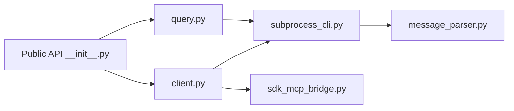

# anthropics/claude-code-sdk-python

> Python SDK to drive Claude Code programmatically: queries, custom tools and hooks.

## The problem
Automating a coding agent from Python forces you to manage the CLI subprocess and the message stream yourself.

## What it actually does
`query()` returns an asynchronous stream of messages; `ClaudeSDKClient` enables bidirectional exchanges, custom tools as in-process MCP servers (`@tool`) and hooks (for example `PreToolUse`). The Claude Code CLI is bundled in the package. Session management: list, resume, import, configurable storage.

## How it is wired


## Trying it
```bash
pip install claude-agent-sdk
```
```python
import anyio
from claude_agent_sdk import query

async def main():
    async for message in query(prompt="What is 2 + 2?"):
        print(message)

anyio.run(main)
```

## Cost and gotchas
Python 3.10+. Usage goes through Claude Code, so authentication and consumption are at your expense. `allowed_tools` pre-approves tools without removing others.

## What it is not
It is not a Messages API client: it drives the Claude Code CLI. It was renamed from Claude Code SDK (`ClaudeCodeOptions` becomes `ClaudeAgentOptions`).

## Alternatives
Not documented: the README names no alternative.

## For you
Adopt if you automate code tasks with agents: official SDK, MIT, very active; accept the dependency on the CLI.
