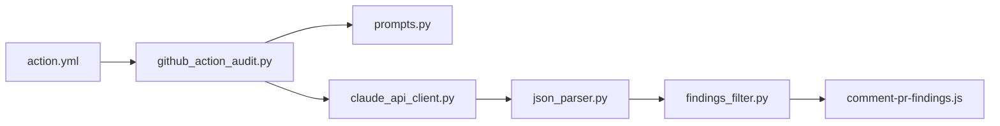

# anthropics/claude-code-security-review

> GitHub Action that has Claude review the security of every pull request.

## The problem
Classic pattern-based SAST tools generate noise and miss logic flaws; human security review of every PR does not scale.

## What it actually does
On a PR, reads only the modified files, builds an audit prompt and calls Claude.
Parses the JSON response and filters out false positives (DoS, rate limiting and open redirects are excluded by default).
Comments on the affected lines and uploads a results file as an artifact.
Also provides an evaluation bench (`evals/`) and the `/security-review` command for Claude Code.

## How it is wired


## Trying it
```bash
cd claude-code-security-review
pytest claudecode -v
```
Real use means adding `anthropics/claude-code-security-review@main` to `.github/workflows/security.yml`.

## Cost and gotchas
Anthropic API key at your expense, enabled for the API and Claude Code; default model is Opus 4.1, so you pay per PR.

## What it is not
Not protected against prompt injection: reserve it for trusted PRs. Does not replace a full audit, only reviews the diff.

## Alternatives
No alternative named in the README.

## For you
Worth watching: handy for an internal MLOps repo where PRs are trusted, but the per-PR cost and the injection risk rule out wiring it to a public repo.
