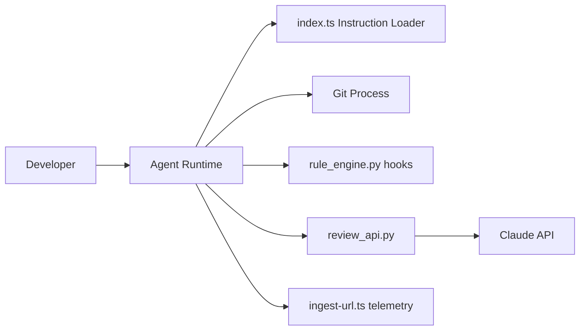

# anthropics/claude-code

> Anthropic code agent in a terminal, IDE, or GitHub: reads the repository, modifies it, and manages Git.

## The problem
Repetitive coding tasks (such as exploring a repository, making corrections, and committing changes) are performed manually, on a file-by-file basis, without any tool that provides a comprehensive view of the entire project.

## What it actually does
You describe the task using natural language; the agent loads the project instructions (`index.ts`), inspects or modifies the repository, runs git, and then provides a result or explanation.
The sample code demonstrates the inspection of git diffs, a rule engine for hooks (`rule_engine.py`), security review plugins (`review_api.py`, `llm.py`), and session telemetry (`ingest-url.ts`).
The public repository mainly contains plugins (commands, agents) and is used for bug tracking; the central orchestration is not visible there.

## How it is wired


## Trying it
```bash
curl -fsSL https://claude.ai/install.sh | bash
brew install --cask claude-code
claude
```

## Cost and gotchas
The README does not provide pricing or offers; it refers to Anthropic's commercial terms. The npm installation is outdated.

## What it is not
This is not an open-source tool: there is no declared license, and the agent's engine is not included in the repository. It collects usage data (e.g., acceptances, associated conversations, feedback via `/bug`).

## Alternatives
No alternative is specified in the README.

## For you
To adopt: this is already your tool; the `plugins` directory in the repository serves as examples of hooks and agents.
