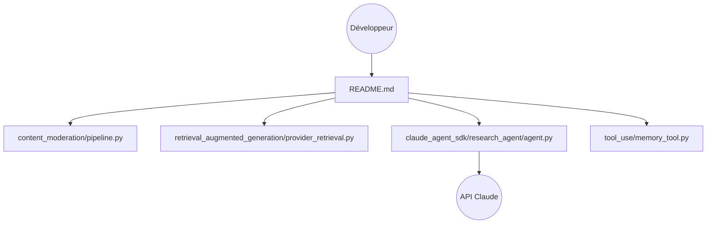

# anthropics/claude-cookbooks

> Code snippets that developers can copy and use when working with the Claude API.

## The problem
Moving from isolated API calls to specific use cases (such as classification, RAG, tools, and agents) requires reliable examples.

## What it actually does
Collection of notebooks and scripts: classification, RAG with reranking, summarization, use of tools (customer service, SQL, memory), vision, sub-agents, JSON, moderation, prompt caching, cost and latency optimization. It also includes examples of agents (`claude_agent_sdk`) with an HTTP server and a Kubernetes gateway. This is not a single runtime.

## How it is wired

## Trying it
There is no single command in the README: open the desired recipe and follow its instructions. The required prerequisite is a Claude API key.

## Cost and gotchas
Claude API key, meaning that calls will be charged. Examples primarily in Python; some require Pinecone, Voyage AI, or MongoDB.

## What it is not
Not a pre-built library or a production product: each recipe is adaptable. The internal workings of several recipes have not been examined.

## Alternatives
No alternative is mentioned in the README (it cites AWS Samples as a supplementary resource).

## For you
A reliable source for RAG (Retrieval-Augmented Generation), tools, and evaluation with Claude; use it as a foundation for examples, reducing the cost of trial calls.
