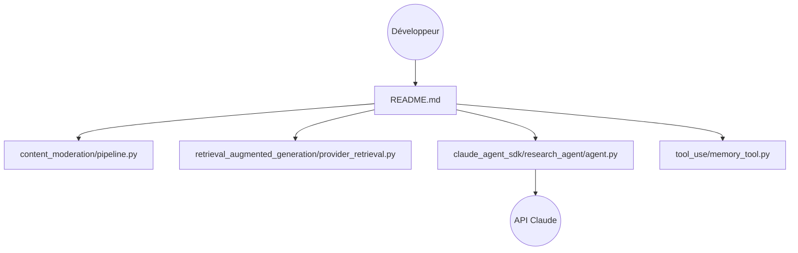

# anthropics/claude-cookbooks

> Recettes de code copiables pour développeurs qui construisent avec l'API Claude.

## Le problème
Passer d'un appel API isolé à des cas concrets (classification, RAG, outils, agents) demande des exemples fiables.

## Ce que ça fait vraiment
Collection de notebooks et scripts : classification, RAG avec reranking, résumé, utilisation d'outils (service client, SQL, mémoire), vision, sous-agents, JSON, modération, cache de prompts, optimisation du coût et de la latence. Elle contient aussi des exemples d'agents (`claude_agent_sdk`) avec serveur HTTP et passerelle Kubernetes. Ce n'est pas un runtime unique.

## Comment c'est branché

## Essayer
Aucune commande unique dans le README : ouvrir la recette voulue et suivre ses instructions. Prérequis cité : une clé d'API Claude.

## Coût et pièges
Clé d'API Claude, donc appels facturés. Exemples surtout en Python ; certains requièrent Pinecone, Voyage AI ou MongoDB.

## Ce que ce n'est pas
Pas une bibliothèque installable ni un produit de production : chaque recette s'adapte. Les internes de plusieurs recettes n'ont pas été examinés.

## Alternatives
Aucune alternative nommée dans le README (il cite AWS Samples en ressource complémentaire).

## Pour toi
Source de référence pour RAG, outils et évaluation avec Claude ; adopte-la comme base d'exemples, en coupant le coût des appels d'essai.

