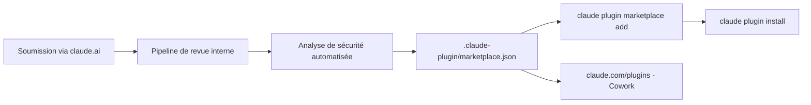

# anthropics/claude-plugins-community

> Read-only mirror of the catalog of community plugins installable in Claude.

## The problem
Finding a trustworthy Claude plugin requires knowing which one has been reviewed and approved.
Without a reference list, everyone installs at random from an unknown repository.

## What it actually does
The `.claude-plugin/marketplace.json` file contains the list of installable community plugins.
It is synced every night from Anthropic's internal review pipeline.
Each listed plugin was submitted via claude.ai, passed an automated security analysis, then approved.
Pull requests opened directly against the repository are closed automatically.

## How it is wired


## Trying it
```bash
claude plugin marketplace add anthropics/claude-plugins-community
claude plugin install <plugin-name>@claude-community
```

## Cost and gotchas
Free. The repository is a mirror: any contribution goes through the submission form, not a PR.
"Approved" means it passed an automated analysis, not that it was audited line by line.

## What it is not
Not the plugins maintained by Anthropic — those are in `anthropics/claude-plugins-official`.
Not a code repository: it contains only the catalog manifest.
Not a place for discussion or public review.

## Alternatives
`anthropics/claude-plugins-official`: the plugins maintained by Anthropic.
`anthropics/knowledge-work-plugins`: plugins aimed at non-technical professions.

## For you
The right entry point for picking a plugin without digging through GitHub; worth bookmarking.
