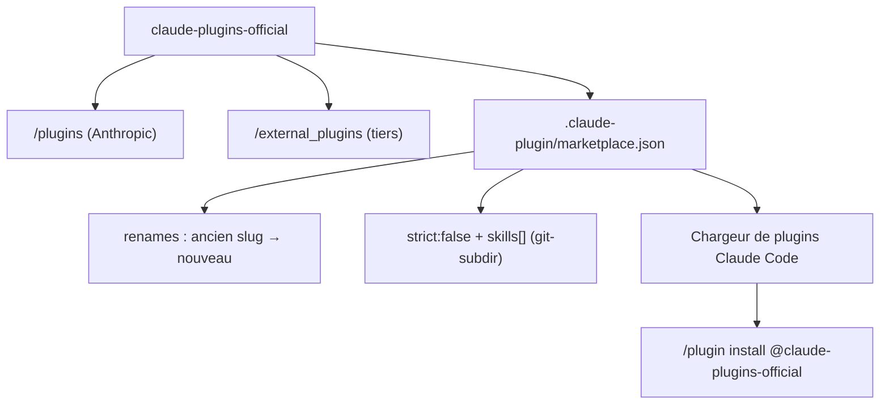

# anthropics/claude-plugins-official

> Claude Code plugin directory, separating Anthropic's internal plugins and third-party plugins.

## The problem
Installing an unknown plugin is equivalent to running unverified MCP code and servers; without a directory, there's no way to distinguish between a legitimate contribution and a random, unverified project.

## What it actually does
Separate two directories: `/plugins` for plugins developed and maintained by Anthropic,
`/external_plugins` for those from partners and the community, submitted via a form and
subject to quality and security criteria.
Define the expected structure of a plugin: a mandatory `.claude-plugin/plugin.json` file, followed by `.mcp.json`,
`commands/`, `agents/`, `skills/` and a README, all of which are optional.
Establish a strict rule: the `name` field is an immutable identifier – changing it breaks
existing installations; the display is modified via `displayName`, and any renaming will inevitably
go through the `renames` table in `marketplace.json`, which the loader applies during the next synchronization. It also describes skill-package plugins, declared with `strict: false`.

## How it is wired


## Trying it
```bash
/plugin install {plugin-name}@claude-plugins-official
```

## Cost and gotchas
Free. The warning is explicitly stated in the README: Anthropic does not control the MCP servers, files, or software embedded in a plugin, and cannot guarantee that they function as intended or that they will not change – the responsibility for this lies with the user. Each plugin's homepage also makes this clear.

## What it is not
This is not a guarantee of security, despite the name "official": the presence in
`/external_plugins` does not guarantee auditing. This is not a readable catalog: the README describes the mechanics, not the list of plugins. This is not a tool, it is a repository of metadata.

## Alternatives
No alternative is specified in the README file.

## For you
A reasonable starting point before looking for plugins on third-party marketplaces.
