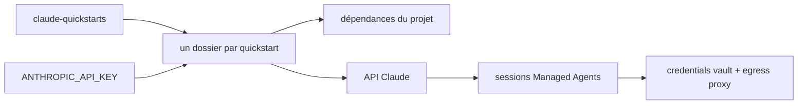

# anthropics/claude-quickstarts

> A collection of starter projects for building applications on the Claude API.

## The problem
Starting from a blank page on an agent API costs days before the first useful result.
The patterns that work (prompt caching, compaction, grouped tools) are not something you invent.

## What it actually does
Each quickstart is a standalone project with its own README and installation instructions.
Covers financial data analysis, computer use (containerized and native macOS), and browser automation via Playwright.
An autonomous coding agent on the Claude Agent SDK, with a two-agent pattern and progress persisted through git.
Eight Managed Agents examples: Chat SDK, CopilotKit/AG-UI, knowledge wiki, Linear, MCP server, scheduler, Sentry.

## How it is wired

## Trying it
No command block in this README: it describes five steps — clone the repo, enter the quickstart's folder,
install the dependencies, set the API key as an environment variable, run the application.

## Cost and gotchas
A Claude API key is required, and every run is billed by usage.
The "Computer Use Best Practices" quickstart runs directly on the macOS desktop: the README says to run it in a VM.

## What it is not
Not a library: nothing to install globally, these are codebases to take over and modify.
Not a supported product: these are foundations to customize to your needs.
Not exhaustive on the API: the README points to the documentation, the cookbooks and the Fundamentals course.

## Alternatives
`Claude Cookbooks` — code snippets and guides for common tasks, cited as a complementary resource.

## For you
The right entry point for a specific pattern (MCP, computer use, knowledge wiki) rather than a linear tutorial.
