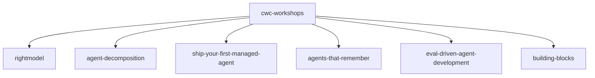

# anthropics/cwc-workshops

> The material from Anthropic's Code with Claude workshops: managed agents, skills, evaluations.

## The problem
The workshops on Claude agents, skills and evaluations are not easy to replay alone without their materials.

## What it actually does
A repository of ten folders, one per workshop: choosing the right model with an evaluation-audit SKILL, breaking an agent down into skills and MCP, deploying a first managed agent, adding memory, developing an evaluation-driven agent (PPTX generation), a multi-agent research team, six small Python programs on the Messages API. Each folder contains its own code.

## How it is wired
Simplified diagram based on the sheet, no diagram provided.

## Trying it
No command documented in the README: open the folder of the workshop you want and follow its instructions.

## Cost and gotchas
The workshops call Anthropic's API, so an API key and a bill at your expense. Several rely on Claude Managed Agents.

## What it is not
Not a product: the README says "Not maintained and not accepting contributions". No guarantee of updates or support.

## Alternatives
No alternative named in the README.

## For you
Worth watching: good training material on agents, evaluations and memory, but frozen and unmaintained, to read rather than adopt.
