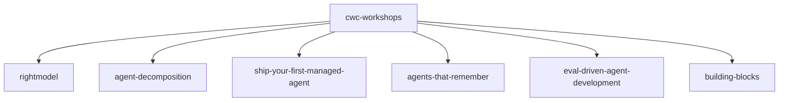

# anthropics/cwc-workshops

> Le matériel des ateliers Code with Claude d'Anthropic : agents gérés, skills, évaluations.

## Le problème
Les ateliers sur les agents Claude, les skills et les évaluations ne sont pas faciles à rejouer seul sans leurs supports.

## Ce que ça fait vraiment
Un dépôt de dix dossiers, un par atelier : choisir le bon modèle avec un SKILL d'audit d'évaluations, décomposer un agent en skills et MCP, déployer un premier agent géré, ajouter de la mémoire, développer un agent piloté par évaluations (génération de PPTX), une équipe de recherche multi-agents, six petits programmes Python sur l'API Messages. Chaque dossier contient son propre code.

## Comment c'est branché
Schéma simplifié d'après la fiche, sans diagramme fourni.

## Essayer
Aucune commande documentée dans le README : on ouvre le dossier de l'atelier voulu et on suit ses instructions.

## Coût et pièges
Les ateliers appellent l'API d'Anthropic, donc une clé et une facture à ta charge. Plusieurs reposent sur Claude Managed Agents.

## Ce que ce n'est pas
Pas un produit : le README dit « Not maintained and not accepting contributions ». Pas de garantie de mise à jour ni de support.

## Alternatives
Aucune alternative nommée dans le README.

## Pour toi
À surveiller : bon matériel de formation sur les agents, les évaluations et la mémoire, mais figé et sans maintenance, à lire plutôt qu'à adopter.

