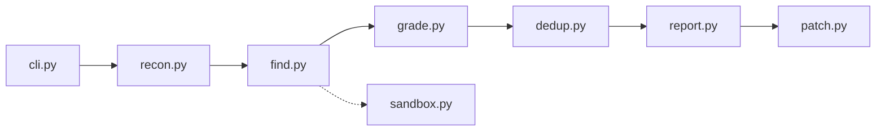

# anthropics/defending-code-reference-harness

> Reference pipeline where Claude finds, verifies and fixes security flaws; for security teams.

## The problem
Finding vulnerabilities in code takes expert time, and automated results drown the team in false positives.

## What it actually does
Provides Claude Code skills (`/quickstart`, `/threat-model`, `/vuln-scan`, `/triage`, `/patch`) and an autonomous pipeline recon → find → verify → dedupe → report → patch. The reference target is C/C++ compiled with ASAN in Docker. A second part (`/dnr-hunt`, `/dnr-respond`) hunts for an attacker in logs. The README states that the repository is neither maintained nor open to contributions.

## How it is wired


## Trying it
```bash
git clone https://github.com/anthropics/defending-code-reference-harness
cd defending-code-reference-harness
claude
> /quickstart
python3 -m venv .venv && .venv/bin/pip install -e .
./scripts/setup_sandbox.sh
bin/vp-sandboxed run drlibs --model <model-id> --runs 3 --parallel --stream --auto-focus
```

## Cost and gotchas
The agents consume API calls at your expense; the pipelines run target code and refuse to run outside a gVisor sandbox (Docker required). The README warns that autonomous triage and patching remain open problems.

## What it is not
Not a product: the README says "reference, not a product" and does not work on any codebase without `/customize`. Not maintained.

## Alternatives
- Claude Security: hosted and managed option, cited in the README.

## For you
Worth watching as an agent architecture model (sandbox, independent verification), more than as a tool to deploy: not maintained and license to clarify.
