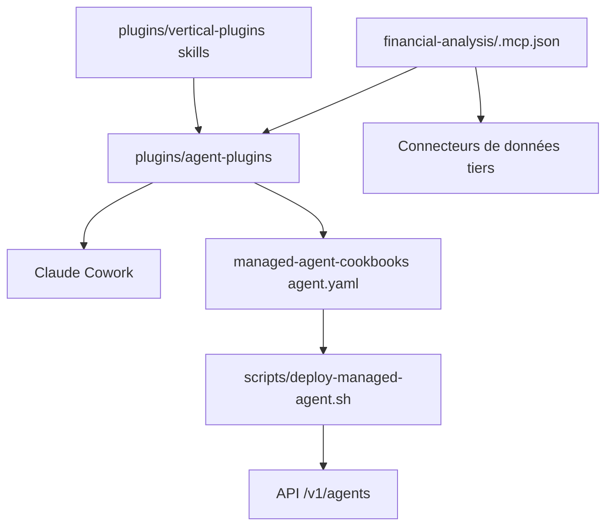

# anthropics/financial-services

> Reference agents, skills and connectors for finance professions, on the Claude side.

## The problem
Financial analyst workflows (comps, DCF, LBO, general ledger reconciliation, KYC) are redone by hand in every firm.
Nothing links the assistant to data terminals and existing Excel/PowerPoint templates.

## What it actually does
Provides agents named by workflow — Pitch Agent, Market Researcher, Earnings Reviewer, GL Reconciler, KYC Screener… — each self-contained, embedding its own skills.
Each agent exists in two forms from the same source: a Claude Cowork plugin, or a template deployed via the Claude Managed Agents API (`/v1/agents`).
Vertical plugins (investment-banking, equity-research, private-equity, fund-admin, operations) group skills, slash commands (`/comps`, `/dcf`, `/earnings`, `/ic-memo`) and MCP connectors.
Eleven MCP connectors centralized in the `financial-analysis` plugin: Daloopa, Morningstar, S&P Global, FactSet, Moody's, LSEG, PitchBook, Box, Egnyte, etc. Everything is markdown and JSON files, with no build step.

## How it is wired


## Trying it
```bash
claude plugin marketplace add anthropics/financial-services
claude plugin install financial-analysis@claude-for-financial-services
claude plugin install pitch-agent@claude-for-financial-services
export ANTHROPIC_API_KEY=sk-ant-...
scripts/deploy-managed-agent.sh gl-reconciler
```

## Cost and gotchas
The MCP connectors often require a subscription or a key with the provider (FactSet, PitchBook, Moody's…): the real bill is there.
Delegation to sub-agents (`callable_agents`) is a research preview; consult the per-agent security notes.

## What it is not
It is not investment advice: the README insists, the agents draft analyst deliverables meant for human validation, they execute no transaction or accounting entry.
They are not finished products: they are templates to adapt to the firm's processes and terminology.
It is not independent of the Claude ecosystem.

## Alternatives
No alternative is named in the README.

## For you
Mostly useful as an architecture model: the skills / agents / connectors structure can be reused outside finance.
