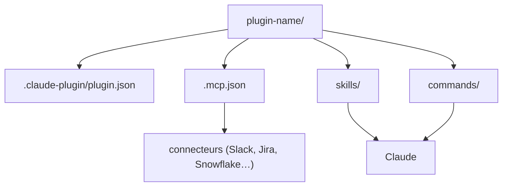

# anthropics/knowledge-work-plugins

> Eleven job-function plugins for Claude Cowork and Claude Code, to adapt to your company's vocabulary.

## The problem
A generic assistant does not know a team's tools, vocabulary and procedures: every request starts over with ten lines of context that you retype.

## What it actually does
Each plugin bundles skills (domain expertise, triggered automatically), explicit slash commands (`/sales:call-prep`, `/data:write-query`, `/finance:reconciliation`) and a `.mcp.json` that wires up the connectors. Eleven domains: productivity, sales, customer-support, product-management, marketing, legal, finance, data, enterprise-search, bio-research and cowork-plugin-management. Everything is markdown and JSON — no code, no build.

## How it is wired


## Trying it
```bash
claude plugin marketplace add anthropics/knowledge-work-plugins
claude plugin install sales@knowledge-work-plugins
```

## Cost and gotchas
The `data` plugin assumes Snowflake, Databricks or BigQuery; `finance` does too. Each connector is a third-party service with its own account and its own bill. The README presents the plugins as generic starting points: the real value comes from the customization work.

## What it is not
Not standalone tools: they exist only in Cowork or Claude Code. Not a turnkey integration — without rewriting the skills with your vocabulary, they stay at the level of a manual. No executable code: these are context files, not programs.

## Alternatives
- `cowork-plugin-management`: the plugin in the repository intended for building others.

## For you
The `data` plugin is worth reading as a model for structuring skills, even without installing it.
