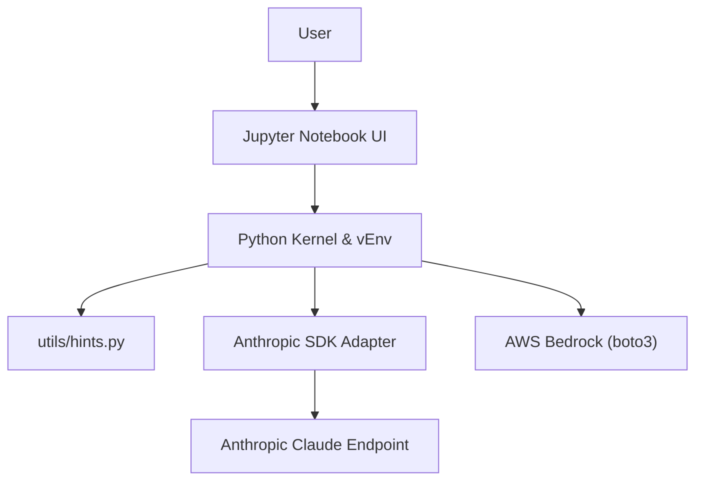

# anthropics/prompt-eng-interactive-tutorial

> Interactive tutorial in Jupyter notebooks for learning to write good prompts with Claude.

## The problem
Writing effective prompts takes guided practice, not just scattered tips.

## What it actually does
Nine chapters with exercises and an experimentation area, plus an appendix (prompt chaining, tools, search). Direct Anthropic and Amazon Bedrock (boto3) editions, with a CloudFormation template and answer keys.

## How it is wired

## Trying it
No command documented in the README: open `01_Basic Prompt Structure`. Dependencies are in `requirements.txt`.

## Cost and gotchas
Anthropic API key (or AWS account) at your expense; the tutorial uses Claude 3 Haiku, which is outdated. A Google Sheets version is considered simpler.

## What it is not
Not an up-to-date guide to the latest models. No license declared.

## Alternatives
The Google Sheets version with Claude for Sheets, cited in the README.

## For you
Worth adopting as a base for prompt engineering, keeping in mind that the target model is outdated.
