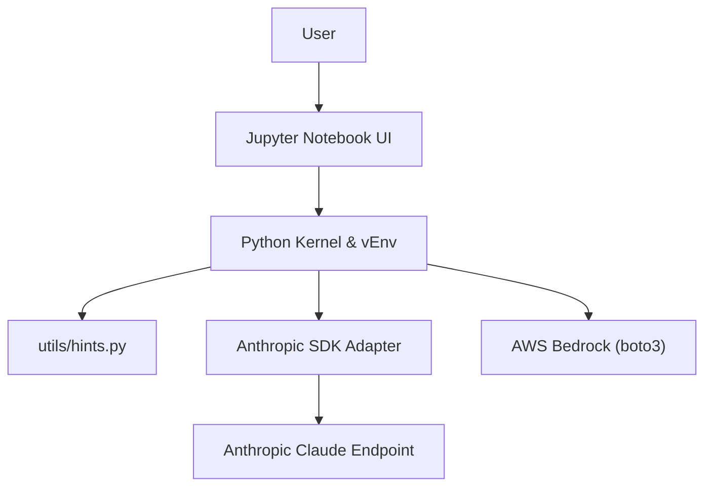

# anthropics/prompt-eng-interactive-tutorial

> Tutoriel interactif en notebooks Jupyter pour apprendre à écrire de bons prompts avec Claude.

## Le problème
Écrire des prompts efficaces demande de la pratique guidée, pas seulement des conseils épars.

## Ce que ça fait vraiment
Neuf chapitres avec exercices et zone d'expérimentation, plus une annexe (enchaînement de prompts, outils, recherche). Éditions Anthropic en direct et Amazon Bedrock (boto3), avec modèle de CloudFormation et corrigés.

## Comment c'est branché

## Essayer
Aucune commande documentée dans le README : ouvrir `01_Basic Prompt Structure`. Les dépendances sont dans `requirements.txt`.

## Coût et pièges
Clé d'API Anthropic (ou compte AWS) à ta charge ; le tutoriel utilise Claude 3 Haiku, ancien. Une version Google Sheets est jugée plus simple.

## Ce que ce n'est pas
Pas un guide à jour sur les derniers modèles. Aucune licence déclarée.

## Alternatives
La version Google Sheets avec Claude for Sheets, citée dans le README.

## Pour toi
À adopter comme base d'ingénierie de prompts, en gardant à l'esprit que le modèle cible est dépassé.

