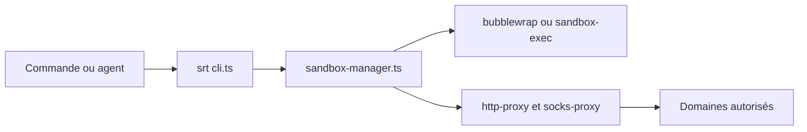

# anthropics/sandbox-runtime

> Lightweight sandbox that restricts a process's files and network, without a container, useful for agents and MCP servers.

## The problem
An agent, an MCP server or a bash command launched as is inherits all your rights: readable SSH keys, open network.

## What it actually does
`srt` wraps a command with operating system primitives: `sandbox-exec` on macOS, bubblewrap on Linux, a dedicated account and a network filter on Windows. The network goes through HTTP and SOCKS5 proxies that apply allowed or denied domain lists. Writing is denied by default, reading is open unless a rule says otherwise. Configured through `~/.srt-settings.json`, via the CLI or as a TypeScript library.

## How it is wired
Simplified diagram based on the fiche, no diagram provided.


## Trying it
```bash
npm install -g @anthropic-ai/sandbox-runtime
srt "curl anthropic.com"
srt "cat ~/.ssh/id_rsa"
srt --settings /path/to/srt-settings.json npm install
```

## Cost and gotchas
Free. Without a settings file: no network, limited writing, free reading. A present but invalid file makes the command fail. The README notes behavior changes between versions.

## What it is not
Not a virtual machine: isolation relies on the host kernel. It is a research preview, whose APIs and formats may change. The Windows filters have documented limits.

## Alternatives
No alternative named in the README.

## For you
Adopt to try out: it restricts a locally run agent or MCP server in a few lines, provided you accept an API that is still moving.
