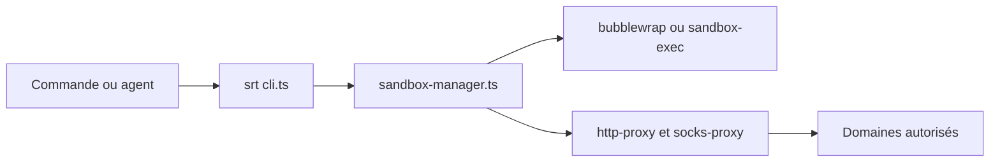

# anthropics/sandbox-runtime

> Bac à sable léger qui limite fichiers et réseau d'un processus, sans conteneur, utile pour agents et serveurs MCP.

## Le problème
Un agent, un serveur MCP ou une commande bash lancés tels quels héritent de tous tes droits : clés SSH lisibles, réseau ouvert.

## Ce que ça fait vraiment
`srt` enveloppe une commande avec des primitives du système : `sandbox-exec` sur macOS, bubblewrap sur Linux, un compte dédié et un filtre réseau sur Windows. Le réseau passe par des proxys HTTP et SOCKS5 qui appliquent des listes de domaines autorisés ou refusés. Écriture refusée par défaut, lecture ouverte sauf règle. Se règle par `~/.srt-settings.json`, en CLI ou en bibliothèque TypeScript.

## Comment c'est branché
Schéma simplifié d'après la fiche, sans diagramme fourni.


## Essayer
```bash
npm install -g @anthropic-ai/sandbox-runtime
srt "curl anthropic.com"
srt "cat ~/.ssh/id_rsa"
srt --settings /path/to/srt-settings.json npm install
```

## Coût et pièges
Gratuit. Sans fichier de réglages : aucun réseau, écriture limitée, lecture libre. Un fichier présent mais invalide fait échouer la commande. Le README signale des changements de comportement entre versions.

## Ce que ce n'est pas
Pas une machine virtuelle : l'isolation repose sur le noyau de l'hôte. C'est une préversion de recherche, dont les API et formats peuvent changer. Les filtres Windows ont des limites documentées.

## Alternatives
Aucune alternative nommée dans le README.

## Pour toi
À adopter pour tester : il restreint en quelques lignes un agent ou un serveur MCP que tu fais tourner en local, à condition d'accepter une API encore mouvante.

