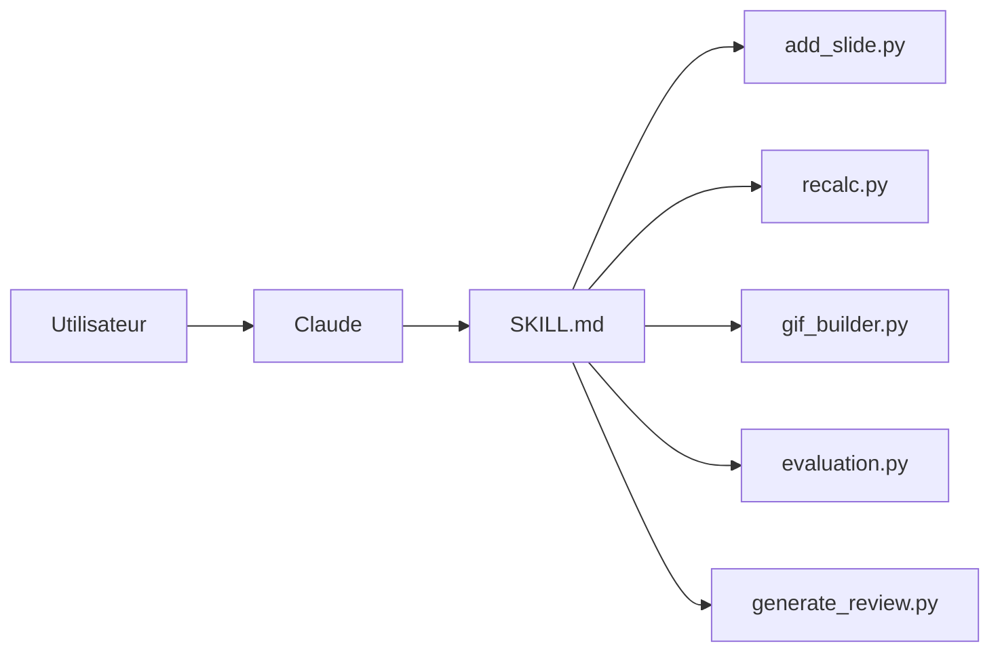

# anthropics/skills

> Key Anthropic reference skills for Claude (documents, design, MCP, testing), to be installed or copied.

## The problem
Instruct an agent to follow a repeatable procedure (e.g., filling out a PDF, editing a .pptx file, creating a skill) without having to explain every step in each prompt.

## What it actually does
Each skill is a standalone folder with a `SKILL.md` file (front matter containing the `name` and `description`, followed by instructions), and sometimes scripts: `add_slide.py` (for PowerPoint), `recalc.py` (for Excel formulas), `gif_builder.py` (for GIFs in Slack), `evaluation.py` (for MCP servers), and `generate_review.py` (for skill evaluation reviews).

The repository also contains the Agent Skills specification (`./spec`) and a template (`./template`).
It is installed as a marketplace for Claude Code plugins, in two sets: `document-skills` and `example-skills`.

## How it is wired


## Trying it
```bash
# commandes à taper dans Claude Code
/plugin marketplace add anthropics/skills
/plugin install document-skills@anthropic-agent-skills
/plugin install example-skills@anthropic-agent-skills
```

## Cost and gotchas
The files are freely accessible, but using them requires a Claude license: a paid subscription to Claude.ai, or an API. There is no license at the repository level; docx/pdf/pptx/xlsx files are "source-available" but not open source.

## What it is not
The README warns: this is a demonstration and educational tool, not a guarantee of Claude's behavior in a production environment. The documentation is not freely reusable, even though it is publicly available.

## Alternatives
- Notion Skills for Claude — These are listed as partner skills for Notion.

## For you
Recommended as a model: read the `skill-creator` and the skills from existing documents before writing your own.
