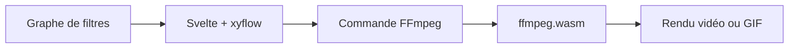

# antiboredom/ffmpeg-explorer

> Visual web tool for composing FFmpeg filters as a graph and getting the command.

## The problem
Complex FFmpeg filter chains are hard to write and to understand.

## What it actually does
Node-based interface (Svelte, xyflow) that runs FFmpeg in the browser thanks to ffmpeg.wasm. Progress bar, render cancellation, enabling and disabling filters, graph export to JSON, GIF output, importable video.

## How it is wired
Simplified diagram based on the fiche, no diagram provided.


## Trying it
```bash
npm install
npm run dev
```

## Cost and gotchas
Free, usable at ffmpeg.lav.io. No license: reuse rights not granted. Last push in July 2024. Multi-threaded rendering fails in Chrome.

## What it is not
Not finished: several features are still to do (input options, audio or image output). Not a free-form command editor.

## Alternatives
- ffmpeg.guide: FFmpeg command generator.
- ffmpeg.app: alternative cited in the README.

## For you
Ignore: a little-maintained convenience tool with no license, useless for a data / AI / MLOps workflow.
