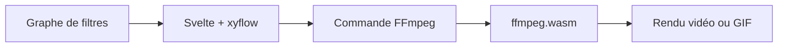

# antiboredom/ffmpeg-explorer

> Outil web visuel pour composer des filtres FFmpeg en graphe et obtenir la commande.

## Le problème
Les chaînes de filtres FFmpeg complexes sont difficiles à écrire et à comprendre.

## Ce que ça fait vraiment
Interface en nœuds (Svelte, xyflow) qui exécute FFmpeg dans le navigateur grâce à ffmpeg.wasm. Barre de progression, annulation du rendu, activation et désactivation des filtres, export du graphe en JSON, sortie GIF, vidéo importable.

## Comment c'est branché
Schéma simplifié d'après la fiche, sans diagramme fourni.


## Essayer
```bash
npm install
npm run dev
```

## Coût et pièges
Gratuit, utilisable sur ffmpeg.lav.io. Aucune licence : droits de réutilisation non accordés. Dernier push en juillet 2024. Le rendu multi-thread échoue dans Chrome.

## Ce que ce n'est pas
Ce n'est pas terminé : plusieurs fonctions sont à faire (options d'entrée, sortie audio ou image). Ce n'est pas un éditeur de commande libre.

## Alternatives
- ffmpeg.guide : générateur de commandes FFmpeg.
- ffmpeg.app : alternative citée dans le README.

## Pour toi
À ignorer : outil de confort peu actif et sans licence, inutile pour un flux data / IA / MLOps.

