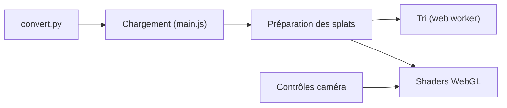

# antimatter15/splat

> Real-time WebGL viewer for 3D Gaussian Splatting scenes, dependency-free, with a PLY to SPLAT converter.

## The problem
Gaussian Splatting scenes are produced as PLY and are not easy to display in a browser.

## What it actually does
Loads a `.splat` file (or converts a dropped `.ply`), sorts the splats by size and opacity in a web worker on the CPU, then renders them with WebGL 1.0 shaders. Keyboard, mouse and touch controls, views saved in the URL, loading through a `url` parameter. Does not display view-dependent effects (spherical harmonics).

## How it is wired

## Trying it
No commands documented. Online demo: https://antimatter15.com/splat/?url=garden.splat

## Cost and gotchas
Free. Hosted files must be CORS-accessible. Sorting runs at ~4 frames per second, with artifacts on camera jumps.

## What it is not
Not a training tool: visualization only. The README points to Spark for more advanced rendering under THREE.js.

## Alternatives
Spark (dynamic 3DGS rendering for THREE.js, cited in the README).

## For you
Handy for showing a 3D reconstruction result in a browser; repo updated as of November 2025: keep an eye on it.
