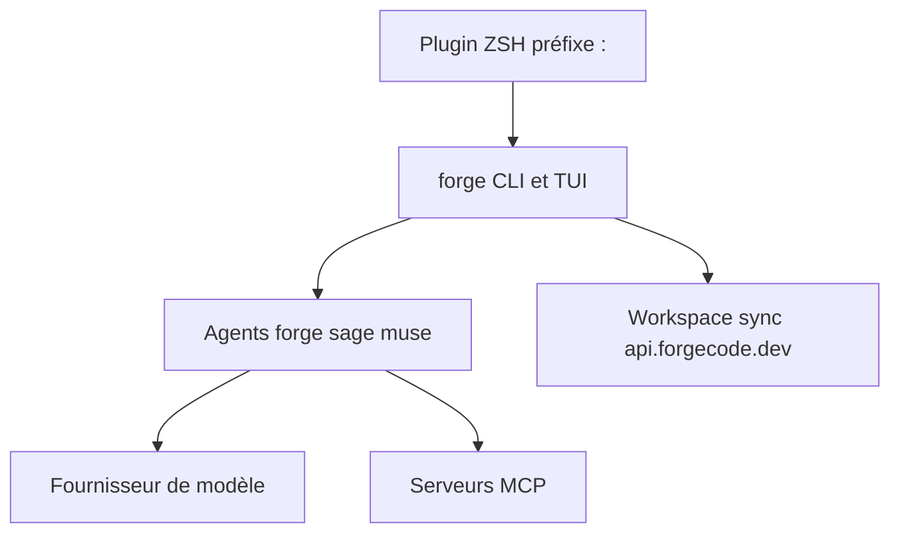

# antinomyhq/forge

> Terminal coding agent (TUI, CLI and ZSH plugin) compatible with several model providers.

## The problem
Using an LLM to code forces you to leave the terminal, copy context and switch between providers.

## What it actually does
Three modes: interactive TUI, one-shot command (`forge -p`), ZSH plugin with `:` prefix. Three agents: forge (modifies files), sage (research), muse (plans). Saved conversations, generated commits, `suggest` for shell commands, skills, MCP, `AGENTS.md`. Semantic search (`:sync`) sends file contents to `api.forgecode.dev` by default.

## How it is wired
Architecture not provided for this repository in the block; diagram limited to what the README says.


## Trying it
```bash
curl -fsSL https://forgecode.dev/cli | sh
forge provider login
forge
forge -p "Explain the purpose of src/main.rs"
forge setup
```

## Cost and gotchas
Free, but a provider API key is at your expense. Semantic indexing transmits code to a remote server, unless self-hosted via `FORGE_WORKSPACE_SERVER_URL`. Configuration via `.env` variables is deprecated. README truncated in the block.

## What it is not
Not a model. Same content as the antinomyhq/forgecode and tailcallhq/forgecode repositories: same stars and same date, probably the same project under several names.

## Alternatives
No alternative named in the README.

## For you
Worth watching: multi-provider terminal agent, but beware of code being sent during indexing.
