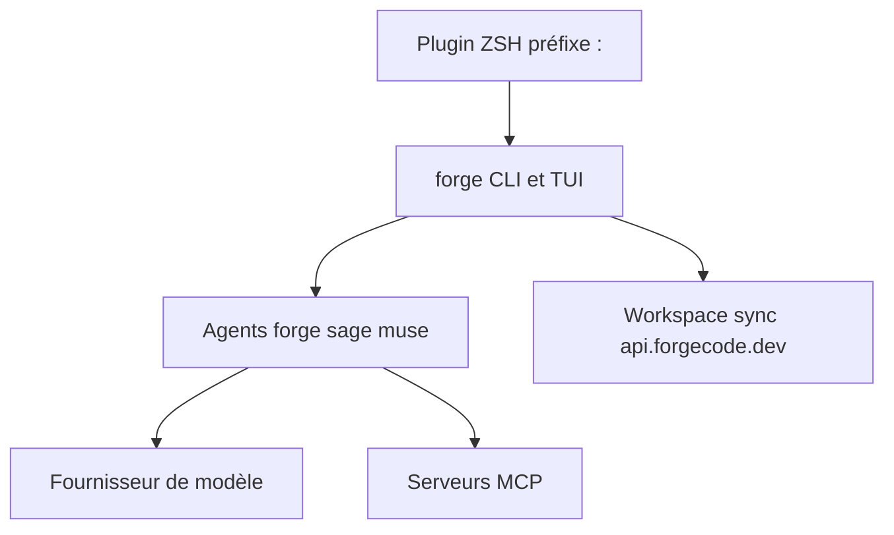

# antinomyhq/forge

> Agent de code en terminal (TUI, CLI et plugin ZSH) compatible avec plusieurs fournisseurs de modèles.

## Le problème
Utiliser un LLM pour coder oblige à quitter le terminal, copier du contexte et basculer entre fournisseurs.

## Ce que ça fait vraiment
Trois modes : TUI interactif, commande unique (`forge -p`), plugin ZSH avec préfixe `:`. Trois agents : forge (modifie les fichiers), sage (recherche), muse (plans). Conversations sauvegardées, commits générés, `suggest` pour les commandes shell, skills, MCP, `AGENTS.md`. La recherche sémantique (`:sync`) envoie le contenu des fichiers à `api.forgecode.dev` par défaut.

## Comment c'est branché
Architecture non fournie pour ce dépôt dans le bloc ; schéma limité à ce que dit le README.


## Essayer
```bash
curl -fsSL https://forgecode.dev/cli | sh
forge provider login
forge
forge -p "Explain the purpose of src/main.rs"
forge setup
```

## Coût et pièges
Gratuit, mais clé d'API d'un fournisseur à ta charge. L'indexation sémantique transmet du code à un serveur distant, sauf auto-hébergement via `FORGE_WORKSPACE_SERVER_URL`. Configuration par variables `.env` dépréciée. README tronqué dans le bloc.

## Ce que ce n'est pas
Pas un modèle. Même contenu que les dépôts antinomyhq/forgecode et tailcallhq/forgecode : mêmes étoiles et même date, sans doute le même projet sous plusieurs noms.

## Alternatives
Aucune alternative nommée dans le README.

## Pour toi
À surveiller : agent de terminal multi-fournisseurs, mais attention à l'envoi de code lors de l'indexation.

