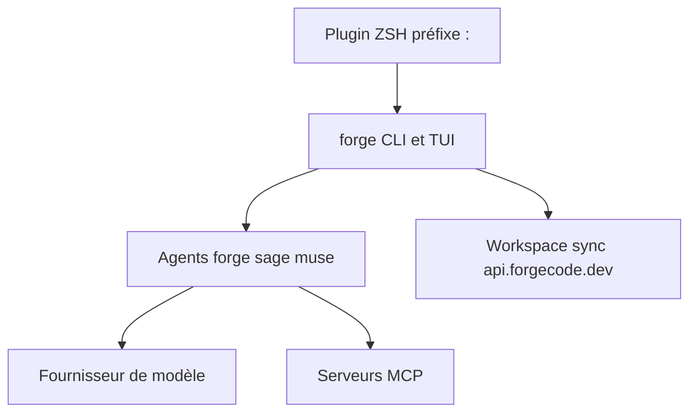

# antinomyhq/forgecode

> Terminal coding agent (TUI, CLI and ZSH plugin) compatible with several model providers.

## The problem
Using an LLM to code forces you to leave the terminal, copy context and switch between providers.

## What it actually does
Three modes: interactive TUI, one-shot command (`forge -p`), ZSH plugin with `:` prefix. Agents forge, sage and muse. Saved conversations, generated commits, skills, MCP, `AGENTS.md`. Semantic search (`:sync`) sends file contents to `api.forgecode.dev` by default.

## How it is wired
Architecture not provided for this repository in the block; diagram limited to the README.


## Trying it
```bash
curl -fsSL https://forgecode.dev/cli | sh
forge provider login
forge
forge commit --preview
forge mcp list
```

## Cost and gotchas
Free, but a provider API key is at your expense. Semantic indexing sends code to the workspace server by default. README truncated in the block.

## What it is not
Not a model. Entry with content identical to antinomyhq/forge and tailcallhq/forgecode (same stars, same push date).

## Alternatives
No alternative named in the README.

## For you
Worth watching: multi-provider terminal agent, with code sent during indexing to be measured before use.
