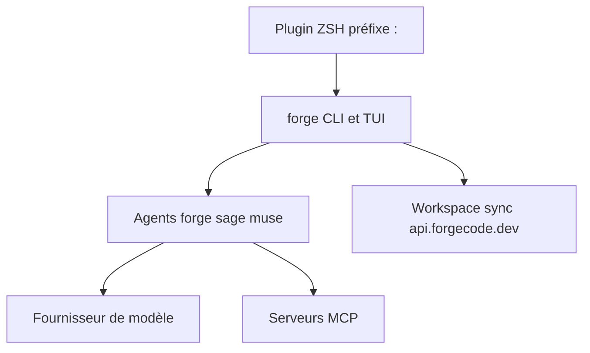

# antinomyhq/forgecode

> Agent de code en terminal (TUI, CLI et plugin ZSH) compatible avec plusieurs fournisseurs de modèles.

## Le problème
Utiliser un LLM pour coder oblige à quitter le terminal, copier du contexte et basculer entre fournisseurs.

## Ce que ça fait vraiment
Trois modes : TUI interactif, commande unique (`forge -p`), plugin ZSH avec préfixe `:`. Agents forge, sage et muse. Conversations sauvegardées, commits générés, skills, MCP, `AGENTS.md`. La recherche sémantique (`:sync`) envoie le contenu des fichiers à `api.forgecode.dev` par défaut.

## Comment c'est branché
Architecture non fournie pour ce dépôt dans le bloc ; schéma limité au README.


## Essayer
```bash
curl -fsSL https://forgecode.dev/cli | sh
forge provider login
forge
forge commit --preview
forge mcp list
```

## Coût et pièges
Gratuit, mais clé d'API d'un fournisseur à ta charge. L'indexation sémantique envoie du code au serveur de workspace par défaut. README tronqué dans le bloc.

## Ce que ce n'est pas
Pas un modèle. Entrée au contenu identique à antinomyhq/forge et tailcallhq/forgecode (mêmes étoiles, même date de push).

## Alternatives
Aucune alternative nommée dans le README.

## Pour toi
À surveiller : agent de terminal multi-fournisseurs, avec envoi de code lors de l'indexation à mesurer avant usage.

