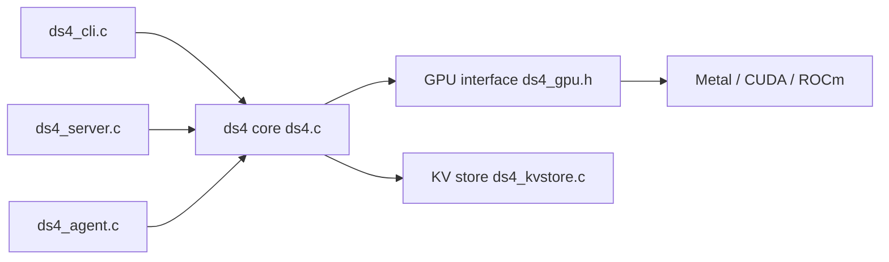

# antirez/ds4

> Narrow native inference engine for a few LLMs (DeepSeek V4, GLM, Qwen) on personal machines.

## The problem
Running large open models on consumer hardware requires general-purpose engines that are hard to optimize for one specific model.

## What it actually does
C engine (`ds4.c`) with Metal, CUDA and ROCm backends, which only reads the project's GGUFs. Ships a CLI, an OpenAI- and Anthropic-compatible HTTP server (`ds4-server`), a native coding agent and an evaluation suite. SSD streaming, on-disk KV cache, tensor parallelism across two Macs over RDMA. Developed "with heavy AI agent assistance", which the README states openly.

## How it is wired


## Trying it
```bash
git clone https://github.com/antirez/ds4.git
cd ds4
make
./download_model.sh ds4f-q2
./ds4 -p "Explain Redis streams in one paragraph."
```

## Cost and gotchas
A 96 to 128 GB machine is recommended for Flash Q2; otherwise fast SSD streaming. The GGUF files are over 100 GB for some models. The README speaks of beta quality with possible regressions.

## What it is not
Not a general GGUF runner. The speed figures are a baseline measured on an M5 Max, not a benchmark of every commit.

## Alternatives
llama.cpp and GGML (credited in the acknowledgements as the basis of the project).

## For you
Worth watching: interesting for local inference of large models on Apple Silicon or DGX Spark, but demanding and unstable hardware requirements.
